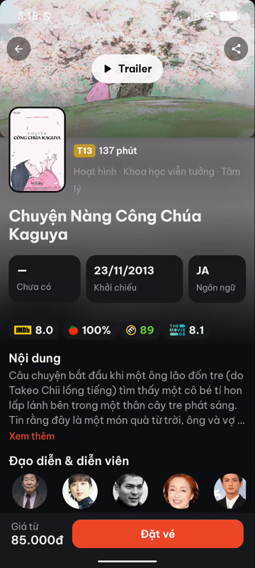
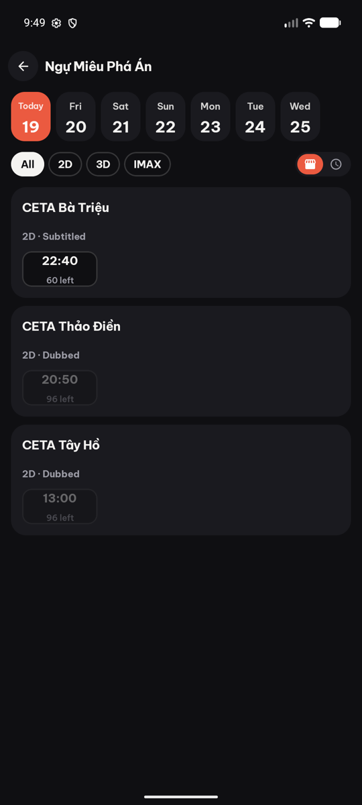

<h1 align="center">CETA Cinema</h1>

<p align="center">
  A cinema ticket-booking app for Android, built with Jetpack Compose.<br>
  Pick a movie, choose seats, pay by VNPay, MoMo or bank transfer, and keep the e-ticket on your phone.
</p>

<p align="center">
  
  
  
  
  <a href="https://github.com/Chunporo/ceta-android/actions/workflows/ci.yml"></a>
  <a href="https://github.com/Chunporo/ceta-android/releases/latest"></a>
</p>

<p align="center">
  
  
  
</p>

<p align="center">
  <a href="docs/demo/ceta-demo.mp4"></a><br>
  <sub>▶ <a href="docs/demo/ceta-demo.mp4">Demo video (80 s)</a>: search, movie page with scores, seats, snacks, payment, e-ticket and member card. Recorded on an emulator against a local backend and the VNPay simulator.</sub>
</p>

> [!NOTE]
> This is a personal learning project, not a commercial product. No real money moves: payments run against simulators (see [Payments](#payments-without-merchant-accounts)).

## Download

The latest signed APK is on the [Releases page](https://github.com/Chunporo/ceta-android/releases/latest) (`CETA-<version>.apk`, with a `SHA256SUMS.txt`). It talks to a demo backend that runs on the author's own machine, so it may be offline; to run everything yourself see [Backend](#backend). Payments go to sandbox or simulator gateways only.

## Features

- **Browse:** now showing and coming soon, search, movie details, reviews and release reminders.
- **Showtimes:** by day, cinema and format (2D, 3D, IMAX), subtitled or dubbed.
- **Seats:** a seat map with standard, VIP and couple seats. Your seats are held for 10 minutes while you pay.
- **Checkout:** snacks, promo codes and CETA loyalty points, with the total recomputed by the server.
- **Payments:** VNPay, MoMo, and VietQR bank transfer. The VietQR screen shows the QR and the transfer note, then waits for the bank to confirm.
- **Tickets:** e-tickets with a QR code, three lists (upcoming, watched, cancelled), your own star rating for a watched show, notifications. A paid ticket can be cancelled until 60 minutes before the show; the refund is requested from the backend and paid back by hand.
- **When things go wrong:** a clear screen when the 10-minute seat hold runs out (choose the seats again) and when a payment fails (retry or pick another method).
- **Search:** accent-insensitive search over movies and cinemas, genre cards, recent searches, trending, and showtime shortcuts.
- **Member card:** a card with your tier, points, a member code and a points history.
- **Scores:** each movie shows the customers' rating plus IMDb, Rotten Tomatoes, Metacritic and TMDB scores when the backend has them, over a wide backdrop image.
- **Accounts:** sign-in with Firebase (Google, phone) or email, account deletion.
- **Look and feel:** dark and light theme, Vietnamese and English.

<p align="center">
  
  
  
</p>

## Tech stack

- Minimum SDK 26, target SDK 37, Kotlin 2.2.
- UI: [Jetpack Compose](https://developer.android.com/jetpack/compose) with Material 3 and Navigation Compose.
- Dependency injection: [Hilt](https://dagger.dev/hilt/).
- Async: Kotlin coroutines and Flow.
- Networking: [Retrofit](https://github.com/square/retrofit), [OkHttp](https://github.com/square/okhttp) and Gson.
- Images: [Coil 3](https://coil-kt.github.io/coil/), also used for the VietQR image.
- QR codes: [ZXing](https://github.com/zxing/zxing) renders the e-ticket QR on the device.
- Local storage: Jetpack DataStore for preferences, plus secure storage for the session.
- Auth: Firebase Authentication.
- Build: Gradle Kotlin DSL with a version catalog, three flavors (`dev`, `staging`, `prod`), R8 for release builds.

## Architecture

The app follows the layering in Android's [architecture guide](https://developer.android.com/topic/architecture): a UI layer of Compose screens and ViewModels, a domain layer of models and small helpers (seat selection, hold timer, payment outcome), and a data layer of repositories over the REST API.

```
app/src/main/java/com/ceta/cinema/
  ui/          Compose screens (one folder per feature), theme, shared components
  domain/      models, seat selection, hold timer, payment outcome
  data/        remote (Retrofit APIs, DTOs), local (preferences, secure storage), repositories
  core/        ApiResult, error mapping, caching, formatters, validators
  di/          Hilt modules
  navigation/  routes and the NavHost
```

- Screens expose a single `UiState`; ViewModels turn repository results into it. Network calls go through a safe-call wrapper that maps failures to `ApiResult` and user-facing errors.
- The server is the source of truth for prices and seat state. The app shows what the server computed and never recomputes a total.
- Payment screens poll the booking until the server marks it paid, so the result does not depend on how the payment provider redirects back.
- The release build keeps the network DTOs and Retrofit generics under R8 (`app/proguard-rules.pro`).

## Backend

The app talks to a Spring Boot backend (separate repository, [`ceta-movie-ticket-backend`](https://github.com/Chunporo/ceta-movie-ticket-backend)) over `/api/v1`. The `dev` flavor points at `http://10.0.2.2:8080/api/v1/`, which is your computer as seen from the Android emulator. Start the backend first, using its README.

## Build and run

Requirements: Android Studio or a JDK 17+ with the Android SDK, and an emulator or device on API 26+.

```bash
./gradlew :app:assembleDevDebug
adb install -r app/build/outputs/apk/dev/debug/app-dev-debug.apk
```

`staging` and `prod` point at `staging-api.ceta.vn` and `api.ceta.vn`, which are placeholders. The `prod` address can be overridden at build time with `-PapiBaseUrl=https://your-host/api/v1/`.

### Release build

The [Release workflow](.github/workflows/release.yml) runs when a tag such as `v1.0.0` is pushed. It runs the unit tests, builds the signed `prod` APK and publishes it, with a checksum, as a GitHub Release. It needs the repository secrets `CETA_KEYSTORE_B64` (the keystore, base64), `CETA_KEYSTORE_PASSWORD`, `CETA_KEY_PASSWORD` and `CETA_KEY_ALIAS`, and the repository variable `API_BASE_URL`. Locally, `assembleProdRelease` produces an unsigned APK unless `CETA_KEYSTORE_FILE` and the three other `CETA_*` variables are set. Register the release certificate's SHA-1 and SHA-256 in Firebase or Google sign-in will fail.

### Continuous integration

Every push and pull request runs the unit tests, Android lint (errors fail the build) and a debug build ([`ci.yml`](.github/workflows/ci.yml)). CI builds with a placeholder `google-services.json`.

Sign-in uses Firebase Authentication. The committed `app/google-services.json` belongs to the author's Firebase project. To use Google or phone sign-in with your own backend, register the app in your own Firebase project and replace that file.

## Testing

```bash
./gradlew :app:testDevDebugUnitTest
./gradlew :app:lintDevDebug
```

## What is sample data

Some screens use sample data until the backend has an endpoint for them (each is marked `TODO` in the code): trending searches, the points history, expiring points and the member code, the tier thresholds and perks text, and the highlight line on offers. The stock photos for snacks, offers and onboarding are for development only (`TODO(release)`), and the IMDb, Rotten Tomatoes, Metacritic and TMDB logos need permission before a public store release.

## Payments without merchant accounts

The backend ships local simulators for VNPay, MoMo and VietQR, so the whole flow works offline. For VietQR, reach the QR screen in the app, then confirm the transfer from the backend repository:

```bash
python3 scripts/vietqr_sim.py CETA3056A1 249000   # <transfer note shown in the app> <amount>
```

The app picks the payment up and opens the e-ticket.
