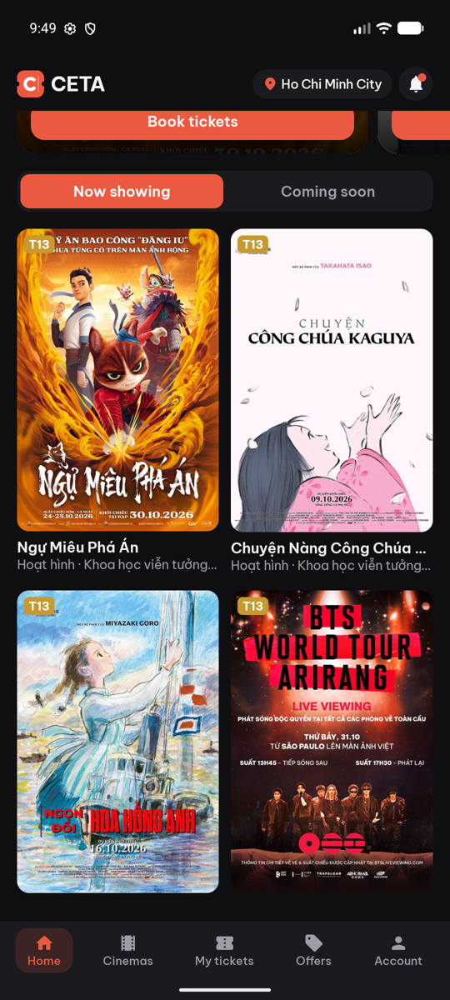
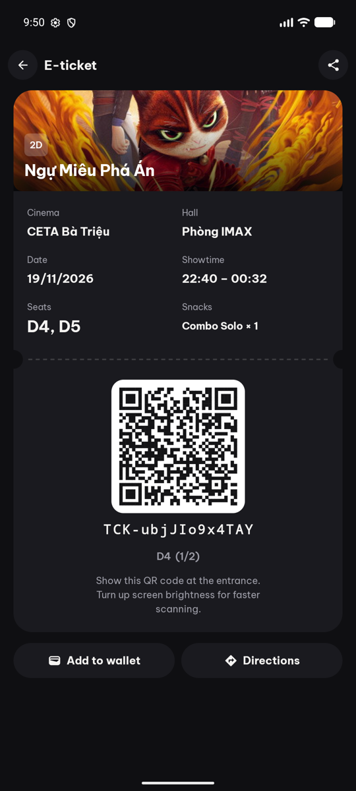

# CETA Cinema – Android

A personal project: a cinema ticket-booking app. Kotlin, Jetpack Compose, Hilt, Retrofit, Coil, Firebase Auth. The backend lives in a separate repo (Spring Boot, `MovieTicketBackend`).

<p>
  
  
  
</p>
<p>
  
  
  
</p>

## Features

- Browse now-showing and coming-soon movies, search, movie details, reviews and reminders.
- Showtimes by day, cinema and format (2D / 3D / IMAX).
- Live seat map with a 10-minute hold while you pay.
- Snacks, promo codes and CETA points at checkout.
- Three payment methods: VNPay, MoMo and VietQR bank transfer. The VietQR screen shows the QR and the transfer note, then waits for the bank to confirm.
- E-tickets with a QR code, order history, notifications, and light/dark theme in Vietnamese and English.

## Build and run

Requirements: Android Studio (or JDK 17+ and the Android SDK), an emulator or device on API 26+.

The `dev` flavor talks to `http://10.0.2.2:8080/api/v1/`, which is the host machine from the emulator. Start the backend first (see its README), then:

```bash
./gradlew :app:assembleDevDebug
adb install -r app/build/outputs/apk/dev/debug/app-dev-debug.apk
```

Other flavors: `staging` and `prod` point at `staging-api.ceta.vn` and `api.ceta.vn`, which are placeholders.

Sign-in uses Firebase Auth. The committed `app/google-services.json` belongs to the author's Firebase project, so to sign in with Google or phone against your own backend, register the app in your own Firebase project and replace that file.

## Tests

```bash
./gradlew :app:testDevDebugUnitTest
```

## Payments without merchant accounts

Nothing here moves real money. The backend ships simulators for VNPay, MoMo and VietQR. For VietQR, check out the QR screen, then confirm the transfer from the backend repo:

```bash
python3 scripts/vietqr_sim.py CETA3056A1 249000   # <transfer note shown in the app> <amount>
```

The app picks up the payment and opens the e-ticket.

## Layout

```
app/src/main/java/com/ceta/cinema/
  data/        Retrofit APIs, DTOs, repositories
  domain/      models
  di/          Hilt modules
  navigation/  routes and NavHost
  ui/          theme, shared components, screens (one folder per feature)
```

The release build is minified with R8; the keep rules for the network DTOs and Retrofit are in `app/proguard-rules.pro`.
